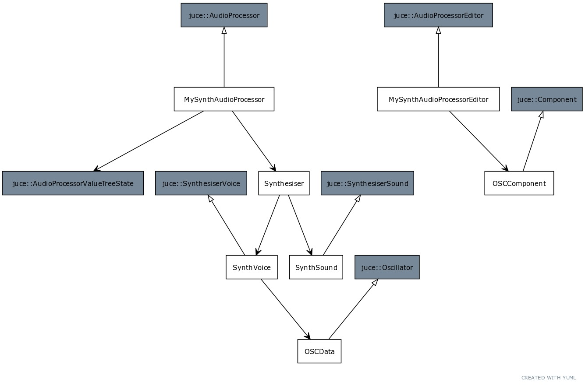

# MySynth

MySynth is a plugin made with the JUCE framework. 

Most of the code from this base was derived from a tutorial by "The Audio Programmer" called TAP Synth.
Here is a [link to the github repo](https://github.com/TheAudioProgrammer/tapSynth) I followed to make this synth

In order to build and run this program, you must first [Install JUCE](https://juce.com/)
Once you do, you can open the "Projucer" The framework's project config manager and setup wizard. open MySynth.jucer, and export to your IDE.
The default build targets are a standalone app as well as a VST3 plugin.

| Source File(s)                      | Description                                                             |
|-----------------------------|-------------------------------------------------------------------------|
| ADSRComponent.cpp & .h      | This is where the GUI for the ADSR is defined.                         |
| ADSRData.cpp & .h           | This is where the sound is manipulated based on the ADSR parameters.   |
| OscComponent.cpp & .h       | This is where the GUI for the Oscillator is defined.                   |
| OscData.cpp & .h            | This is where the sound is manipulated based on the Oscillator parameters. |
| PluginEditor.cpp & .h       | The editor window for my plugin. Components like the Oscillator and ADSR are added to it. |
| PluginProcessor.cpp & .h    | The outermost layer of audio generation. Passes a sample to SynthVoice. |
| SynthSound.h                | Enables the synthesizer to make noise.                                 |
| SynthVoice.cpp & .h         | Contains the oscillators and ADSR, controls polyphony.                 |

## Class Diagram
